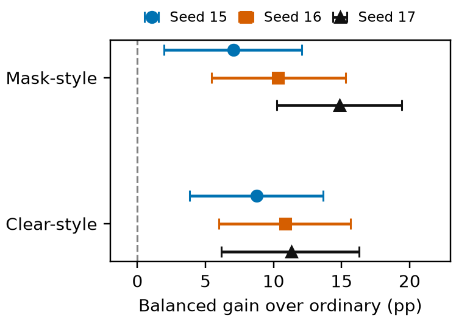

# CLIP Surgery Turns DCSM into a Spatial Relationship Detection Head

Authors and affiliations to be determined.

## Abstract

A learned dense cross-modal scorer may become incompatible with CLIP features when the visual readout is changed. We combine frozen CLIP readout surgery with readout-specific adaptation of the DCSM scorer and trainable functional-word vectors, using complete BPE-span replacement consistently in training and inference. Under matched initialization across three training seeds, adapted MaskCLIP-style and ClearCLIP-style readouts improve spatial relationship selection over the adapted ordinary readout, whereas transferring the ordinary-trained scorer to modified features without adaptation substantially degrades selection. Neither modified readout has a stable advantage across seeds. Removing or reversing relation words changes predictions, while giving every candidate the same image crop produces equal scores. These controls expose sensitivity to both query wording and candidate-specific visual context. Here, a spatial relationship detection head denotes conditional scoring over supplied candidate and reference boxes, not an evaluated end-to-end detector. The results do not establish general compositional superiority or isolate BPE correction as the cause of improvement.

## Introduction

CLIP learns a shared image-text embedding space through contrastive language supervision [@radford2021clip]. Its pooled representations support semantic matching, but image-level alignment does not establish which of several same-class objects satisfies a spatial description. Conditional spatial selection requires distinguishing candidates by their relationship to a reference object, rather than by object category alone.

Dense Cosine Similarity Maps (DCSM) retain pairwise similarities between image patches and text tokens and use a lightweight learned scorer instead of a single pooled cosine score [@kang2025dcsm]. This representation gives the scorer access to patch-token structure. DCSM also replaces the entries associated with selected functional words by fixed random vectors; the scoring network, not those vectors, is learned in the published method. Dense scoring therefore offers a framework for spatial selection, but its behavior depends on the visual features supplied to it.

MaskCLIP and ClearCLIP motivate readout surgery for dense vision-language inference [@zhou2021maskclip; @lan2024clearclip]. MaskCLIP uses value-path features, whereas ClearCLIP emphasizes final-block attention output with self-self attention and removes residual and feed-forward paths. These approaches motivate our local Mask-style and Clear-style readouts; their segmentation results do not establish compatibility with a learned DCSM scorer.

We test whether such readouts improve DCSM-based spatial selection after readout-specific adaptation, and whether an ordinary-trained scorer can be transferred without adaptation. We keep the CLIP encoder frozen and adapt a scorer and trainable functional-word vectors for each readout, with consistent complete BPE-span replacement. Within each training seed, the three variants share initialization and training inputs. This separates adapted-system comparisons from frozen-scorer transfer.

The experiments yield three observations:

- Both modified readouts exceed the adapted ordinary readout on spatial selection in all three training seeds.
- Readout-specific adaptation recovers accuracy lost when the ordinary-trained scorer is transferred unchanged.
- Readout rank reversals and text/crop controls limit stronger claims about spatial understanding.

The evaluation supplies candidate and reference boxes. Thus, the detection head in the title is a conditional scorer, not an end-to-end detector. Three seeds on one automatically constructed benchmark do not establish broad compositional superiority; negation and affirmation serve as non-spatial diagnostics.

## Related Work and Scope

DCSM supplies the dense image-by-text matrix and learned scoring framework [@kang2025dcsm]. Its method and appendix specify fixed random functional-row replacement. Our trainable vectors and BPE-span alignment are local choices, not a novel replacement operation. MaskCLIP motivates value-path features; its original ViT adaptation adds the input residual [@zhou2021maskclip]. ClearCLIP removes residual and feed-forward paths with self-self attention [@lan2024clearclip]. Our residual-bypassed Mask-style and query-query Clear-style readouts are local variants, not full segmentation pipelines.

OWL-ViT and OWLv2 are pretrained open-vocabulary detectors [@minderer2022owlvit; @minderer2023owlv2]. Their supplied-candidate scores also depend on localization and matching. Fine-grained evaluation highlights distinctions beyond recognizing an object category [@bianchi2023fgovd]. Our benchmark uses COCO annotations [@lin2014coco], but candidate boxes and reference context are given to the scorer. Consequently, neither selection accuracy nor a gap to an OWL comparator is an end-to-end detection result or an isolated language-understanding measure.

## Methods and Evaluation

### Frozen readouts and learned scoring

All three adapted readout variants share a frozen CLIP ViT-B/16 encoder at 224-pixel input resolution. Each image sequence has 197 positions, including CLS, and each text sequence has 30 positions, including special tokens and padding. Projected visual and textual features are individually $\ell_2$-normalized before their pairwise similarities form a $197\times30$ matrix.

The ordinary readout uses the final hidden states. Let $Q_h$ and $V_h$ be the query and value projections of the normalized input to the last transformer block for attention head $h$. The Mask-style readout applies the attention output projection directly to concatenated values. The Clear-style readout uses
$$
 A_{h}=\mathrm{softmax}_{\mathrm{key}}(Q_{h}Q_{h}^{\mathsf{T}}/\sqrt{d_h}),
 \qquad Z_{h}=A_{h}V_{h},
$$
where $d_h$ is the head width. Both local styles bypass the ordinary residual and feed-forward paths at that block. ClearCLIP motivates this choice: residual features can obscure local distinctions, and their removal changes the input seen by the feed-forward network [@lan2024clearclip]. Attention-only output avoids retaining these components, but we do not isolate their individual effects on spatial selection. Our Mask-style variant differs from the original MaskCLIP ViT adaptation, which retains the input residual [@zhou2021maskclip]. The same post-layer normalization and visual projection map all three readouts into the joint embedding space.

A trainable 197-dimensional vector replaces every BPE column of a complete standalone occurrence of one of eleven functional words: above, below, left, right, small, big, not, no, without, but and absent. Prefix and occurrence encodings must match the CLIP tokenizer; BOS, EOS and padding are protected. Repeated occurrences are handled separately, and a truncated occurrence is skipped as a unit. A learned vector is repeated over all columns in its BPE span. The matrix shape is retained by the local span-replacement rule.

The scorer has two padded $3\times3$ convolutions with four channels, ReLU nonlinearities, a flattened 128-unit layer and a scalar output. Similarities, after functional-word replacement, are standardized using the mean and sample standard deviation of the entire scoring tensor. Training standardizes the image-by-caption batch; evaluation standardizes the candidate set for one query.

### Matched three-seed training

For each of seeds 15, 16 and 17, we train three separate scorers and functional-vector sets for 27 epochs, each with its own optimizer. Within each seed, initial scorer and vector values are identical across readouts, as verified by saved parameter fingerprints. A shared frozen forward pass supplies identical images, captions and augmentations to the readout variants.

Training pairs spatial Objaverse composites with CUTMIX negatives, color and small/big composites with mirrored counterparts, and negated COCO-training pairs. Each epoch samples all three datasets down to the smallest dataset and uses both caption orderings. Each version uses eight original and eight opposite images with sixteen captions. Shuffled image and text axes yield an identity-matching objective: row and column cross-entropies are accumulated over six dataset/version batches; gradients are divided by three before the Adam step. The learning rate is $10^{-3}$, batch size eight and dropout zero. Augmentation uses perspective distortion 0.05 with probability 0.2, rotation within $\pm4$ degrees, and independent 2% RGB-entry white and black perturbations, with black taking precedence. No RandomResizedCrop is applied.

### Conditional candidate selection

Every item supplies two to six same-class boxes and one target. Query construction uses a fixed seed zero with caps of six candidates, sixty per class and two per image in the relevant generator loops. Evaluated queries retained here comprise spatial (527), negation (315) and affirmation (194). The spatial subset covers 375 images; queries from the same image are not independent. Targets are constructed from annotation geometry and contextual rules, not independently adjudicated human referring expressions.

The adapted scorers use padded candidate crops. For spatial queries, the crop is the union of each candidate and the supplied reference box, padded by 10% on every side and clipped to the image. Negation and affirmation use the nearest reference-class box when available. Crop geometry itself changes with the candidate. CLIP crop/context comparators use pooled embeddings; six dense comparators average full-image patch heatmaps inside the supplied boxes, using EOS or a maximum over content text tokens. OWL comparators select maximum query logits over detections with IoU at least 0.5, or the best-IoU logit minus ten when no detection matches. These comparators differ in context, crop and score rules.

### Metrics and two uncertainty sources

Raw top-1 is the fraction of correct selected candidates; random-choice chance is the mean of $1/N$. Balanced top-1 equally weights target-largest and target-not-largest strata for each retained subset. Box area, not annotation mask area, defines this split. This size-balanced metric adjusts candidate-area imbalance; it is not a size-query evaluation and does not correct all size or contextual shortcuts.

Across training seeds, we report means, sample standard deviations and saved 95% Student-$t$ intervals (two degrees of freedom). Separately, a paired percentile bootstrap resamples whole images 10,000 times, retaining their queries and recomputing balanced stratum ratios with fixed checkpoints. Its per-seed and fixed-three-seed-mean intervals do not cover a joint population of seeds and images. Precision is limited; exploratory intervals are not multiplicity-adjusted.

| Method | Spatial | Negation | Affirmation |
|–-|–-:|–-:|–-:|
| OWLv2 | 42.5 / 43.2 | 36.8 / 39.5 | 46.9 / 45.3 |
| OWL-ViT | 42.3 / 43.8 | 34.6 / 41.8 | **47.4** / 44.2 |
| CLIP crop | 43.8 / 44.2 | 52.4 / 53.0 | 39.2 / 38.3 |
| CLIP context | 39.3 / 39.0 | 33.7 / 34.6 | 45.9 / 46.2 |
| Adapted ordinary | 58.8 / 59.0 | 38.7 / 40.4 | 46.6 / **47.2** |
| Adapted Mask-style | **69.4** / **69.8** | 44.4 / 45.7 | 44.5 / 44.4 |
| Adapted Clear-style | 69.1 / 69.4 | 39.7 / 39.4 | 43.1 / 41.5 |
| Naive / EOS | 49.3 / 50.3 | 44.1 / 48.0 | 27.3 / 26.4 |
| Naive / token-max | 49.5 / 50.0 | 53.7 / **55.7** | 37.1 / 36.3 |
| Maskclip / EOS | 39.3 / 39.4 | 52.4 / 51.1 | 37.1 / 36.5 |
| Maskclip / token-max | 43.3 / 43.4 | 49.2 / 49.9 | 37.6 / 36.3 |
| Clearclip / EOS | 39.7 / 39.4 | **54.0** / 48.8 | 41.8 / 42.2 |
| Clearclip / token-max | 42.5 / 42.5 | 51.4 / 48.1 | 35.1 / 35.5 |

**Table 1.** Top-1 accuracy (%), raw / balanced. Adapted rows are three-seed means; other rows are invariant across seeds, not independent replications. Query counts: spatial 527, negation 315, affirmation 194. Crop, context and scoring rules differ across methods. Modified maps are local styles, not full segmentation systems. Bold marks the highest displayed raw and balanced value separately within each task; it does not indicate statistical superiority. Per-seed values, strata and intervals are in the supplement.
%

## Results

### Spatial gains and unstable ordering

Spatial raw means are 58.8%, 69.4% and 69.1% for ordinary/Mask-style/Clear-style (Table 1), with seed SDs 4.0/2.1/3.3 pp. Balanced means are 59.0/69.8/69.4%, weighting 233 target-largest and 294 other queries equally. This particular size stratification does not remove the gain.

Mask-style minus ordinary balanced gains are 7.1, 10.3 and 14.8 pp for seeds 15/16/17; Clear-style gains are 8.8, 10.9 and 11.3 pp. The per-seed paired image-cluster intervals in Figure 1 are positive for both contrasts. With the three trained checkpoints held fixed, the mean balanced gains are 10.7 pp [7.1,14.4] and 10.3 pp [6.5,14.0]. These brackets describe image sampling, not uncertainty from additional training runs.

Clear-style ranks higher in seeds 15/16, but Mask-style ranks higher in seed 17. Their mean raw difference is 0.3 pp; its fixed-three-seed image interval [$-2.2$,2.6] pp does not demonstrate equivalence. Saved absolute-accuracy seed-$t$ intervals (supplement) are broad with three seeds. Overlapping absolute intervals are not a paired test.

**Figure 1.** Balanced spatial gains relative to the separately adapted ordinary readout, for each training seed. Error bars are paired 95% image-cluster percentile intervals from 10,000 draws of 375 images (527 queries). Symbols identify fixed checkpoints, not independent image samples. The dashed line denotes zero gain. These bars exclude training-seed population uncertainty.
%

### Adaptation versus frozen-scorer transfer

Using the ordinary-trained scorer and vectors on modified features without retraining yields spatial means of 33.7% (Mask-style) and 28.5% (Clear-style), below 45.6% random-choice chance. Separate adaptation gains are 35.7 and 40.7 pp, positive in every seed and per-seed paired image interval. Saved across-seed gain $t$ intervals are [30.8,40.6] and [30.0,51.4] pp; fixed-three-seed image intervals are [30.5,40.7] and [36.0,45.2] pp. They answer different uncertainty questions.

Adaptation changes both the CNN and learned vectors, whereas transfer retains both ordinary-trained components. This supports readout-specific compatibility, not isolated CNN/vector effects or intrinsic feature quality.

### No broad compositional dominance

Spatial gains do not extend uniformly (Table 1). Adapted negation means (40.4%,45.7%,39.4%) trail CLIP crop (53.0%); affirmation also lacks a uniform gain. Negation and affirmation use different populations, not a controlled negation intervention. These diagnostics do not establish a general compositional advantage.

## Controls and Interpretation

### Normalization and query sensitivity

All 527 spatial items are included in the saved control evaluation. Per-candidate normalization standardizes each candidate separately; fixed normalization uses a mean and sample SD calibrated on sixteen deterministic, evenly spaced spatial training samples in a $16\times16$ image-by-caption tensor. No evaluation queries enter that calibration. With trained parameters unchanged, prediction-change rates range from 4.0% to 7.0% for per-candidate normalization and 9.9% to 15.0% for fixed training normalization across readouts and seeds. These controls show that the evaluation decision can depend on set-level standardization, even when overall accuracy changes little. They neither invalidate the main protocol nor certify invariance under arbitrary candidate sets.

Removing the relation phrase changes 42.9–49.5% of predictions across readouts and seeds; replacing it by the opposite relation changes 53.5–69.8%. The altered text is encoded again and receives the same BPE logic-vector rule. These changes are evidence of prediction sensitivity to the intervention, not proof of correct relation semantics. The reported altered-query hit rates retain the *original* target; opposite directions can admit multiple valid candidates, so the saved reversal control is not reversed-label accuracy. The crop and the supplied reference remain unchanged during these text interventions.

### Common-crop ties are structural

A further control replaces candidate-specific union crops by the common union of all candidate boxes and the reference box. The scorer then receives identical image/text representations for every candidate, without a candidate identity feature. Every saved score vector ties within a spread below $10^{-6}$ for all seeds and readouts. First-index argmax selects candidate zero and attains 49.1% original-target accuracy. This is a property of the representation and target-index distribution, not successful grounding on a common image crop. It exposes the role of candidate-specific crop geometry in the current selector.

A correct prediction need not isolate a language-only mechanism: both text and crop changes affect the system, and candidate-set normalization couples candidates. The controls do not establish which shortcuts remain. Saved success/failure examples are the first five matching cases per readout and seed, not a random visual sample or human annotation.

## Limitations and Reproducibility

BPE-span replacement is held fixed across all three readout variants; no otherwise-matched token-replacement alternative isolates its causal effect. Matched initialization does not certify deterministic execution across hosts. Normalization uses no epsilon, so zero-standard-deviation failures remain possible on unseen inputs.

The benchmark supplies same-class candidates, a reference box or reference-class boxes, and automatically derived targets. Full-image dense averaging, candidate crops and detector matching are different inference regimes. We do not measure new detection AP, proposal recall or localization pointing for these newly trained scorers. 

Three seeds and one benchmark do not cover independent datasets, unseen templates or alternative training distributions. Image-cluster intervals condition on exported checkpoints and automatic annotation rules. Correlated queries and the coarse candidate-area split limit inference. Human label validation, training/evaluation image-identity overlap and pretrained-data overlap remain unverified; sampled filenames and indices alone do not establish disjoint images.

The verified export includes source hashes, commands, nine successful stage exit codes, initialization fingerprints, sampled indices, histories, predictions, calibration and checkpoint identifiers. All exported hashes/byte counts and saved aggregates were checked by CPU analysis. This establishes artifact consistency, not fresh training/inference reproduction. Checkpoints were not loaded or distributed here. Original training archives, a complete pinned runtime and upstream execution revision are unavailable; source hashes do not identify an upstream Git commit.

The supplementary material provides query-construction rules, per-seed results, calibration details and both uncertainty types. These supporting records do not resolve the missing label, overlap or reproduction checks.

## Conclusion

Under BPE-aligned replacement and matched within-seed initialization, adapted local MaskCLIP- and ClearCLIP-style readouts improve conditional spatial selection over an adapted ordinary readout in three training seeds. Ordinary-scorer transfer is substantially worse, indicating a coupled representation/scorer compatibility requirement. Rank reversals, weak non-spatial results and structural common-crop ties prevent a stronger compositional claim. Future assessment requires independent labels and datasets, explicit overlap auditing and a selector that preserves candidate identity on a common representation; these are proposals, not completed experiments.

## Acknowledgements

This work was created as part of the No-More-Slops group activities at Pseudo Lab.

## References

Bibliographic records are in `references.bib`; exact source evidence and coverage limitations are in `evidence/citation_evidence.md`. Citation keys are checked against that bibliography.
