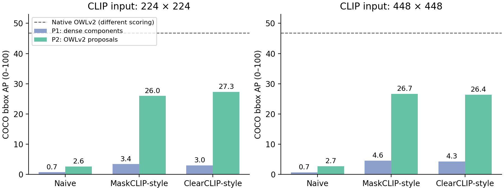
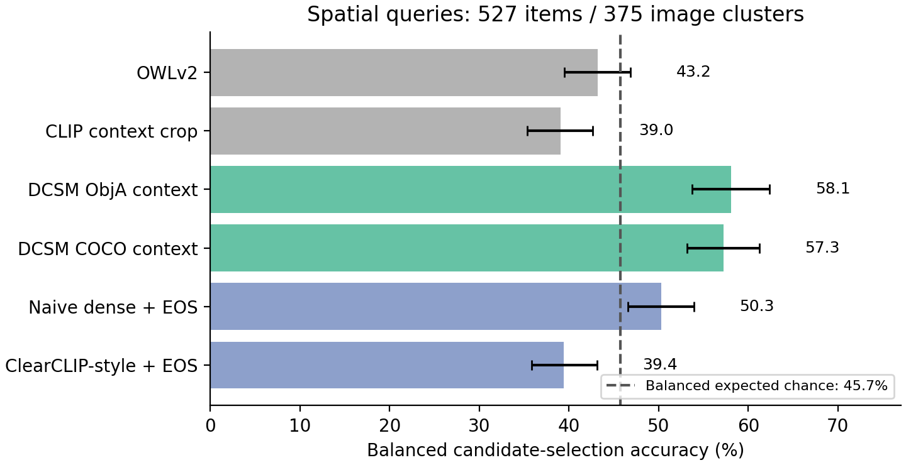

# From Dense CLIP Maps to Object Selection: A COCO Study of Localization and Compositional Transfer

*Working manuscript, 10 October 2026. Author names, affiliations, and a target venue have not been assigned. This draft analyzes saved experiments and a new CPU-only bootstrap of saved predictions; model inference was not rerun during drafting.*

## Abstract

Improving the spatial discriminability of vision-language features does not necessarily improve selection among objects described by relations. We study this distinction using a frozen CLIP ViT-B/16, three final-block feature readouts, and two text aggregation rules. On 4,952 eligible COCO val2017 images, replacing the ordinary dense readout with a ClearCLIP-style readout raises proposal-based detection AP from 2.6 to 27.3 at 224-pixel input resolution when both use the pooled text embedding. Nevertheless, dense connected-component detectors remain weak, and native OWLv2 reaches 46.8 AP under a different scoring protocol. We also evaluate 1,833 automatically constructed queries requiring selection among annotated objects of the same category. Reweighting size-related strata exposes large shortcut effects: OWLv2 size accuracy falls from 64.7% raw to 41.7% balanced. On spatial queries, released DCSM scoring networks achieve 58.1% and 57.3% balanced accuracy against 45.7% expected chance, while the ClearCLIP-style pooled readout reaches 39.4%. Negation results are uneven and affected by construction asymmetry. These observations separate category-sensitive localization from compositional candidate selection in the evaluated pipelines. They support further controlled tests of how dense maps are aggregated, without establishing a general reasoning limitation or a new state-of-the-art detector.

## 1. Introduction

CLIP enables visual recognition by comparing image and text representations learned from natural-language supervision.[1] Using its representations for object-level tasks raises two different questions. First, does a category query produce a useful spatial response? Second, can a description identify the intended instance when several objects share the same category? A heatmap that highlights every person can be effective for category localization while failing to identify the person to the left of a bicycle.

Existing work addresses different parts of this problem. MaskCLIP and ClearCLIP modify how dense features are extracted for segmentation.[3][4] Dense Cosine Similarity Maps (DCSMs) retain image-patch and text-token interactions and pass them to a learned scorer.[2] These approaches motivate an empirical question: do improvements in category-sensitive dense maps transfer to selecting objects described by attributes and relations?

We examine this question in three stages. An oracle-class localization probe checks whether spatial features identify annotated object regions. A detection study evaluates dense connected-component boxes and classification on proposals supplied by OWLv2. Finally, a candidate-selection study uses COCO annotations to construct queries with one target among two to six same-category objects. The final stage supplies candidate boxes and, for context crops, reference-object annotations. It therefore tests a conditional selection problem rather than end-to-end referring-expression detection.

The observations are consistent across several measures but have distinct scopes. Architectural readout changes substantially improve the evaluated proposal-based detector. Dense maps alone remain insufficient for strong detection. In candidate selection, released DCSM networks perform better on spatial relations than the evaluated map-pooling rules, whereas improved dense localization does not consistently improve relational selection. Size-dependent construction biases explain a large part of some raw accuracies. We provide the evaluation details, size-reweighted results, image-cluster uncertainty estimates, and construction caveats needed to interpret these findings.

This is an empirical analysis of existing components. We do not introduce MaskCLIP, ClearCLIP, DCSM, or OWL detectors, and we do not establish that the query collection is a novel benchmark. The contribution proposed for this draft is the documented comparison between localization and conditional compositional selection, together with the audit of shortcuts that affect that comparison.

## 2. Related Work

**Dense feature extraction.** MaskCLIP investigates annotation-free dense label prediction from pretrained CLIP features.[3] ClearCLIP analyzes the effect of the final block's residual and attention pathways on segmentation, and modifies the block to obtain more discriminative dense representations.[4] We implement readouts inspired by these designs in a common Hugging Face CLIP model. Our experiments concern these particular readouts and downstream rules; they are not reproductions of all configurations or segmentation benchmarks in either original paper.

**Dense image–text scoring.** Kang et al. introduce DCSMs and fixed functional rows for compositional terms, followed by a trained convolutional scorer over token–patch similarities.[2] Their analysis concerns geometric conditions on an ideal embedding space. It should not be read as a universal impossibility theorem for every downstream use of CLIP. Their paper also discusses the prospect of studying edited CLIP features.[2] Our learned-scorer arm uses released checkpoints on ordinary features; our surgery arm pools dense maps directly. We do not evaluate a learned DCSM scorer trained on surgically modified maps.

**Open-vocabulary detection and fine-grained evaluation.** OWL-ViT transfers image–text pretraining to detection using detection fine-tuning.[5] OWLv2 extends this line with a self-training recipe for scaling detection supervision.[6] Native detector results provide useful performance references, but differ from the frozen-CLIP arms in training, architecture, and scoring. Fine-grained evaluation of open-vocabulary detectors already has precedent in FG-OVD.[8] Our annotation-derived COCO collection emphasizes selection between same-category instances and includes spatial and attachment-based descriptions; this distinction alone does not demonstrate novelty over the broader literature.

## 3. Methods

### 3.1. Frozen encoder and final-block readouts

All dense-map arms share `openai/clip-vit-base-patch16`. No encoder parameters are updated. Whole images are resized anisotropically to a square using bicubic interpolation and normalized with CLIP's channel statistics. Inputs of 224 and 448 pixels produce 14 × 14 and 28 × 28 patch grids, respectively; the latter uses interpolated positional embeddings. This whole-image preprocessing differs from the standard resize-and-center-crop processing used for candidate crops.

Let (X) be the input to the final vision transformer block, (H=\mathrm{LN}_1(X)), and (Q=W_QH), (V=W_VH) its head-wise query and value projections. We compare the following final-block outputs:

\[
 Z_{\rm naive}=\mathrm{Block}(X),\qquad
 Z_{\rm mask}=W_O V,\qquad
 Z_{\rm clear}=W_O\left[\mathrm{softmax}(QQ^\top/\sqrt{d_h})V\right].
\]

Multi-head outputs are merged before the output projection. Each variant receives the same post-layer normalization, visual projection, and L2 normalization. The MaskCLIP-style variant uses projected value features, and the ClearCLIP-style variant uses query–query attention; both omit the final block's residual and feed-forward paths. We retain patch features and discard the image CLS position for dense maps.

For a query (q), let (t_{\rm EOS}(q)) be the normalized pooled text embedding and (t_j(q)) a normalized projected token embedding. Two scalar patch maps are evaluated:

\[
 h_{\rm pooled}(p,q)=z_p^\top t_{\rm EOS}(q),\qquad
 h_{\rm tok}(p,q)=\max_{j\in\mathcal C(q)} z_p^\top t_j(q).
\]

The token-max content set excludes BOS, EOS, and padding but includes ordinary prompt words, such as articles and prepositions. Text is padded or truncated to 30 positions. Token-max does not explicitly preserve the order of the similarity columns after aggregation; the contextual token embeddings themselves still depend on the input sentence. It is a reduction of a token–patch matrix, not the trained DCSM scoring network.

### 3.2. Localization and detection protocols

The localization probe uses the first 500 eligible COCO val2017 images in sorted image-ID order. For each category present in an image, pointing accuracy tests whether the maximum-scoring patch center lies inside any non-crowd ground-truth box of that category. The unit is an image–category pair, not an individual instance. A second oracle-class metric upsamples and min–max normalizes each heatmap, thresholds it at 0.5, and extracts the connected component containing its maximum. It counts a hit if the resulting box has IoU at least 0.5 with any box of that category. These oracle-class measures do not require resolving competing category labels.

For detection, class prompts are `a photo of a {category}.` for the 80 COCO categories. We use two protocols:

- **P1, dense components:** upsample cosine maps to pixels, apply a class softmax with multiplier 100, assign each pixel to the winning class if its probability exceeds 0.3, and obtain boxes from connected components of at least four pixels. A component's maximum class probability is its detection score. SciPy's default two-dimensional component connectivity is used.
- **P2, OWLv2 proposals:** select the top 100 OWLv2 boxes by sigmoid objectness. Average each class's patch-map values over patch centers inside a box, with a fallback patch for boxes containing no centers. Apply the same 80-way softmax multiplier, retain three classes per box, and score each box–class pair by objectness times its class probability.

The native OWL references instead apply a sigmoid to class logits and retain the top 300 box–class pairs over their predicted boxes. Thus P2 and native OWLv2 share a box-producing model but do not use an identical evaluated proposal subset or confidence rule. Their AP difference cannot be attributed solely to CLIP classification. Within P2, proposals and scoring rules are shared across readout variants.

Evaluation uses standard COCO bounding-box AP averaged over IoU thresholds 0.50–0.95. The eligible set contains 4,952 images with at least one non-crowd annotation, rather than all 5,000 val2017 images. All reported AP values use a 0–100 scale. OWL-ViT v1 and OWLv2 use `google/owlvit-base-patch32` and `google/owlv2-base-patch16-ensemble`, respectively. Their training and backbones are not matched to the frozen CLIP arms.

### 3.3. Annotation-derived candidate-selection queries

COCO provides annotated object instances in natural scenes.[7] We derive five query subsets from its val2017 annotations. Each item supplies all eligible annotated instances of category (A) in an image as candidates, with (2\leq N\leq6), and one target. All non-crowd instances of (A) must pass a minimum annotation-area ratio of 0.002 and minimum box side length of 24 pixels. Collection generation uses seed 0, a per-category cap of 60 items within each subset, and a per-image cap of two items within each subset.

**Size.** A big target has COCO annotation area at least three times that of the next-largest instance. Otherwise, a small target is allowed when its annotation area is at most one third of the next-smallest and at least 0.004 of the image area. The implementation uses `ann["area"]`, rather than bounding-box area. Its `if/elif` structure prioritizes big descriptions when both conditions hold, contributing to the observed 575 big versus 80 small queries.

**Color.** Instance masks are eroded before HSV-based color estimation. A target color must occupy at least 55% of the remaining mask pixels and exceed the second-largest color share by a factor of 2.5. Its share in every distractor must be at most 12%. Additional class, mask-size, and near-synonym filters are applied. These automatic labels have not received a systematic human validation sufficient to estimate benchmark-wide error.

**Spatial relation.** The reference category (B) has one annotated instance. A target (A) must lie on the requested side of (B), with separation and a center margin of 0.05 of the corresponding image dimension. All other (A) centers lie on the opposite side. The four relations are left, right, above, and below. These are image-plane relations derived from boxes, not three-dimensional spatial judgments.

**Without and with.** For predefined host and portable-object categories, attachment is a proxy computed from boxes: at least 30% overlap relative to the smaller box, or containment of either box's center in the other. A without query requires exactly one candidate with no attached (B); a with query requires exactly one candidate with an attached (B). The builder checks without first using `if`, then with using `elif`, subject to per-image caps. When (N=2), the underlying one-attached/one-detached configuration satisfies both conditions and is preferentially assigned to without when that subset's cap allows. Consequently, these subsets are not matched positive/negative controls. Two-candidate items account for 273/315 without items but only 44/194 with items.

**Table 1.** Query counts and expected accuracy of uniform random candidate selection. Images overlap between subsets: the complete collection contains 1,025 distinct images. Strata in the last column are big/small for size and target-largest/not-largest by box area for the other subsets.

| Subset | Items | Images | Categories A | Raw chance (%) | Stratum counts |
| --- | --- | --- | --- | --- | --- |
| Size | 655 | 608 | 68 | 43.1 | 575 / 80 |
| Color | 142 | 136 | 39 | 44.1 | 90 / 52 |
| Spatial | 527 | 375 | 57 | 45.6 | 233 / 294 |
| Without | 315 | 243 | 17 | 47.4 | 74 / 241 |
| With | 194 | 153 | 16 | 33.4 | 117 / 77 |

### 3.4. Candidate scorers

We evaluate 12 scorers. Native OWL query predictions are matched to each candidate by IoU at least 0.5, taking the maximum matching query logit. If no prediction matches, the best-IoU prediction's logit is used with a penalty of 10. These arms mix localization and description scoring even though candidate boxes are supplied for evaluation.

CLIP crop scores compare the image CLS embedding with the query EOS embedding. Crops add 10% padding on each side. A context-crop variant uses the union of each candidate and the supplied reference box for spatial items. For without/with items, it uses the union with the nearest (B) by center distance. Size and color use the ordinary candidate crop. These unions require privileged annotation information and can change the target's scale and layout within the processed image.

The two released DCSM checkpoints, locally named ObjA and COCO, score the same context crops with an already trained CNN over a 197 × 30 similarity matrix. The CNN has two convolutional layers and a 128-unit hidden fully connected layer. The frozen CLIP encoder supplies ordinary final-block features, including CLS. The adapter loads the checkpoint's functional-row embeddings and lookup, inserts rows using the inherited whitespace-position convention, and standardizes similarities jointly across all candidate crops for one query. Scores therefore depend on the candidate batch. We preserve this adapter behavior rather than silently replacing token alignment or normalization. We have not independently verified that this convention matches the intended tokenizer positions in every query.

Finally, six whole-image dense-map scorers combine the three readouts with pooled or token-max text. They average patch similarities inside candidate boxes at resolution 224. No class softmax or DCSM CNN is applied in these arms. None of the methods receives new training for this evaluation, but the released DCSM scorers and native OWL models are trained components.

### 3.5. Metrics, balancing, and uncertainty

Raw accuracy is the fraction of correct candidate choices; expected chance is the item average of (1/N). To reduce a dominant size shortcut, balanced accuracy equally weights the two strata in Table 1:

\[
 A_{\rm bal}=\tfrac12\left(\frac{\sum_{i\in S_0}\mathbf{1}[\hat y_i=y_i]}{|S_0|}
                         +\frac{\sum_{i\in S_1}\mathbf{1}[\hat y_i=y_i]}{|S_1|}\right).
\]

Balanced chance applies this formula to (1/N_i), so it need not be 50%. For size, balancing concerns query polarity; for other subsets, it concerns whether the target is the largest candidate by box area. This adjustment does not balance categories, relation words, layouts, or candidate count.

We additionally bootstrap saved candidate predictions using 10,000 image-cluster resamples within each subset, seed 20261010. A resampled image contributes all its items with the same multiplicity. Stratum means are recomputed and equally weighted in each replicate; all methods share the same resampled images. We report percentile 95% intervals and paired differences. These exploratory intervals describe variability of the constructed sample conditional on its labels, candidate set, and checkpoints. They do not cover annotation errors, pretraining overlap, or alternative task construction, and no multiple-comparison correction is applied. Detection and localization intervals cannot be recovered from the available aggregate summaries.

## 4. Results

### 4.1. Dense readout changes improve oracle-class localization

**Table 2.** Pointing accuracy on the 500-image oracle-class probe (%). Each trial asks whether the maximum patch falls in any box of the known category. These measures do not evaluate which same-category instance a relational query intends.

| Readout | Pooled, 224 | Token-max, 224 | Pooled, 448 | Token-max, 448 |
| --- | --- | --- | --- | --- |
| Naive | 12.0 | 10.4 | 11.8 | 12.2 |
| MaskCLIP-style | 51.4 | 37.1 | 57.1 | 45.4 |
| ClearCLIP-style | 62.4 | 52.5 | 67.5 | 56.8 |

The ordinary dense readout localizes poorly by this measure. Both modified readouts improve pointing accuracy substantially, and the pooled text embedding outperforms token-max for each modified readout and resolution. ClearCLIP-style pooled features reach 62.4% at 224 and 67.5% at 448. Oracle threshold-box hit rate also rises from 5.1% for naive pooled features to 26.3% for ClearCLIP-style pooled features at 224. The probe is a sorted, non-random subset, and it tests category-level spatial responses with oracle class information.

### 4.2. Readout gains are much larger with supplied proposals

**Table 3.** COCO bbox AP on 4,952 eligible images (0–100). P1 obtains boxes from dense components; P2 supplies top-100 objectness proposals from OWLv2. Native OWL references have different training and scoring. Values rounded to 0.0 can represent a small nonzero AP.

| Readout | Text | P1, 224 | P2, 224 | P1, 448 | P2, 448 |
| --- | --- | --- | --- | --- | --- |
| Naive | Token-max | 0.0 | 1.2 | 0.0 | 1.5 |
| Naive | Pooled | 0.7 | 2.6 | 0.7 | 2.7 |
| MaskCLIP-style | Token-max | 2.6 | 20.3 | 3.2 | 20.9 |
| MaskCLIP-style | Pooled | 3.4 | 26.0 | 4.6 | 26.7 |
| ClearCLIP-style | Token-max | 3.5 | 22.8 | 4.6 | 21.2 |
| ClearCLIP-style | Pooled | 3.0 | 27.3 | 4.3 | 26.4 |

Native reference AP is 28.8 for OWL-ViT v1 and 46.8 for OWLv2; these are separate protocols, not P2 configurations.



**Figure 1.** Pooled-text AP from Table 3. The dashed line is a native OWLv2 performance reference with different proposal selection and confidence scoring. Error bars are unavailable for detection summaries.

Within P2 at 224, AP rises from 2.6 for naive pooled features to 26.0 for MaskCLIP-style and 27.3 for ClearCLIP-style features. This within-protocol comparison supports a strong readout effect in the implemented proposal-based detector. It does not measure pure classification accuracy: AP still depends on proposals, confidence calibration, and ranking.

P1 remains weak, with a maximum displayed AP of 4.6 across these configurations. Sharper class responses therefore do not yield a competitive detector under this connected-component rule. Native OWLv2 reaches 46.8 AP; its 19.5-point lead over the best P2 configuration spans differences in representation, training, proposal selection, and confidence scoring.

Higher resolution is not uniformly beneficial. MaskCLIP-style pooled P2 improves from 26.0 to 26.7, but ClearCLIP-style pooled P2 falls from 27.3 to 26.4. This contrast with pointing accuracy cautions against using localization-probe gains as a direct predictor of detection gains.

### 4.3. Raw candidate accuracy is affected by size shortcuts

**Table 4.** Raw and size-balanced candidate-selection accuracy (%) for selected scorers. Each cell is raw / balanced. Full results for all 12 scorers appear in Appendix A. Without/with use attachment-based labels and are not matched controls.

| Scorer | Size | Color | Spatial | Without | With |
| --- | --- | --- | --- | --- | --- |
| Chance | 43.1 / 37.6 | 44.1 / 43.5 | 45.6 / 45.7 | 47.4 / 48.1 | 33.4 / 33.0 |
| OWLv2 | 64.7 / 41.7 | 74.6 / 73.5 | 42.5 / 43.2 | 36.8 / 39.5 | 46.9 / 45.3 |
| OWL-ViT v1 | 69.5 / 44.4 | 67.6 / 63.9 | 42.3 / 43.8 | 34.6 / 41.8 | 47.4 / 44.2 |
| CLIP crop | 45.8 / 36.8 | 69.7 / 69.2 | 43.8 / 44.2 | 52.4 / 53.0 | 39.2 / 38.3 |
| CLIP context crop | 45.8 / 36.8 | 69.7 / 69.2 | 39.3 / 39.0 | 33.7 / 34.6 | 45.9 / 46.2 |
| DCSM ObjA context | 43.5 / 38.2 | 64.8 / 65.7 | 57.9 / 58.1 | 38.4 / 38.7 | 47.4 / 47.8 |
| DCSM COCO context | 49.3 / 38.8 | 61.3 / 61.7 | 56.9 / 57.3 | 38.1 / 37.5 | 46.4 / 46.0 |
| ClearCLIP-style pooled | 42.4 / 39.8 | 57.0 / 57.6 | 39.7 / 39.4 | 54.0 / 48.8 | 41.8 / 42.2 |

A model-free largest-box heuristic obtains 87.3% raw size accuracy; the smallest-box heuristic obtains 72.7% raw without accuracy. Thus high raw accuracy can arise without reading the query. Reweighting big/small items reduces OWLv2's size result by 23.0 percentage points and OWL-ViT v1's by 25.1 points. The balanced largest-box size heuristic is 49.7%, slightly below 50% because query labels use annotation area while the heuristic uses box area. Model-free rules are not guaranteed to equal 50% under every stratum definition.

Color behaves differently: OWLv2 obtains 73.5% balanced accuracy and CLIP crop obtains 69.2%, versus 43.5% balanced chance. These results show useful candidate-level color discrimination on the filtered items. Because candidate crops isolate objects and labels are automatically generated, they do not by themselves establish general attribute binding in multi-object scenes.

### 4.4. Learned DCSM scoring performs better on the spatial subset

The two released DCSM networks reach 58.1% and 57.3% balanced spatial accuracy, compared with 39.0% for CLIP context crops and 45.7% expected chance. In contrast, the ClearCLIP-style pooled map scorer reaches 39.4%; MaskCLIP-style pooled maps reach 39.4% as well. Naive pooled maps obtain 50.3%, so DCSM is not the only scorer numerically above chance.

**Table 5.** Spatial accuracy and selected paired differences from the image-cluster bootstrap. Accuracy intervals are in percent; difference intervals are in percentage points. The 527 items belong to 375 image clusters.

| Quantity | Estimate | Exploratory 95% interval |
| --- | --- | --- |
| DCSM ObjA balanced accuracy | 58.1% | [53.7, 62.4]% |
| DCSM COCO balanced accuracy | 57.3% | [53.2, 61.2]% |
| DCSM ObjA minus chance | +12.4 pp | [+8.0, +16.7] pp |
| DCSM COCO minus chance | +11.5 pp | [+7.4, +15.5] pp |
| DCSM ObjA minus CLIP context crop | +19.1 pp | [+14.3, +23.9] pp |
| DCSM ObjA minus ClearCLIP-style pooled | +18.7 pp | [+13.1, +24.2] pp |



**Figure 2.** Selected spatial scorers with percentile 95% intervals from 10,000 image-cluster resamples. The dashed line shows expected chance under the balanced metric. The comparisons span different scoring architectures and input construction; they do not isolate CNN topology, functional rows, training, or crop geometry individually.

These comparisons support the practical benefit of the evaluated pretrained DCSM pipeline on this spatial collection. They also show that category-localization improvements from architectural surgery do not consistently transfer to the implemented mean-map candidate scorer. They cannot establish that surgery harms a learned DCSM network: that combination was not evaluated. A controlled factorial comparison would require training or adapting scorers to each dense representation under matched supervision.

### 4.5. Attachment-based negation has inconsistent transfer

On without items, the DCSM checkpoints obtain 38.7% and 37.5% balanced accuracy, below 48.1% expected chance. However, naive token-max maps obtain 55.7%, and CLIP candidate crops obtain 53.0%. It would therefore be incorrect to conclude that every evaluated method fails to exceed chance on this subset. Numeric improvements are also not sufficient to establish understanding of negation, since residual shortcuts remain.

Context changes are substantial: CLIP drops from 53.0% with candidate crops to 34.6% with context crops on without items, while its with accuracy rises from 38.3% to 46.2%. This shows sensitivity to the adapter's input construction. It does not cleanly isolate linguistic polarity because the two subsets differ in candidate count, target-size distribution, and builder branch priority. Furthermore, box overlap and center containment may label incidental proximity as attachment, and absence of an annotated object need not establish visual absence. We treat these results as an exploratory transfer diagnostic.

## 5. Discussion and Limitations

**Localization and selection require separate validation.** The same ClearCLIP-style readout that improves oracle-class pointing and P2 AP does not improve pooled-map spatial selection relative to ordinary dense features. Category-sensitive spatial features and a useful relational decision rule are distinct empirical requirements. A plausible explanation is that simple map averaging discards interactions useful for selection, whereas the learned scorer exploits richer token–patch patterns. The present experiment does not identify that mechanism causally; training and crop differences provide alternative explanations.

**The evaluation is conditional and annotation-driven.** Ground-truth candidate boxes eliminate candidate discovery for crop/map arms, and reference annotations supply context. Native OWL scores still depend on detection matching. COCO's 80 categories provide category-conditioned detection prompts, so this study does not measure unseen-category generalization. The query collection contains only filtered instances and templated language. Class caps and size balancing leave other selection biases intact.

**The query labels are proxies.** HSV color labels may disagree with human judgments under illumination or mixed colors. Size refers to annotation area, not perceived scale. Attachment is geometric overlap, not verified possession or physical contact. The without/with generation asymmetry prevents a controlled polarity comparison. These issues can alter apparent compositional ability independently of a model's language understanding.

**Training and uncertainty are incompletely audited.** Released DCSM and OWL models have prior training; frozen evaluation is not evidence of training-free model development. Released checkpoint identities, exact original training-example lists, and pretraining image overlap have not been audited sufficiently to certify split disjointness for every component. Bootstrap intervals reflect resampling observed images only. They do not replace label validation, multiple independent collections, or controlled reruns.

**This is a saved-artifact analysis.** Detection summaries and candidate predictions are retained in the repository, and candidate aggregates were recomputed and matched to saved results. The drafting pass did not rerun inference. Its recorded Git revision identifies the evidence snapshot, not the unknown revision that originally generated every result. Software requirements are available, but an exact original package inventory, checkpoint hashes, and a complete hardware/runtime record are not established by these artifacts. Saved total elapsed time is not a matched per-method speed benchmark.

**Scientific positioning remains provisional.** The observed comparisons are useful for diagnosis, but novelty relative to dense CLIP and compositional-evaluation literature needs a fuller audit. The present draft supports a scoped empirical report. Stronger claims would require validated labels; paired positive/negative items; matched candidate scoring and confidence rules; a learned-scorer-by-readout factorial experiment; and evaluation on independent referring-expression or fine-grained datasets.

## 6. Conclusion

On the evaluated COCO pipelines, modifying frozen CLIP's final-block readout improves category-sensitive localization and proposal-based detection. Those gains do not consistently improve conditional selection of objects described by spatial relations. Released DCSM scorers show a spatial-selection advantage on this constructed sample, while size shortcuts and asymmetric attachment queries complicate broader claims. Measuring localization, proposal-based detection, and compositional candidate selection separately makes these boundaries visible and provides a concrete basis for the next controlled experiment.

## Acknowledgements

This work was created as part of the No-More-Slops group activities at Pseudo Lab.

AI assistance was used to inspect evaluation code, organize evidence, draft prose, and produce CPU-only statistical summaries and plots from saved predictions. Scientific claims, authorship, and submission details require review by the human authors. No independent peer review is implied by the accompanying internal review notes.

## Appendix A. Complete Candidate-Selection Tables

The names `dcsm_tok`, `negation`, and `affirm` below retain the evaluation code's identifiers. In the text these are described as token-max, without, and with.

<!-- GENERATED_RAW_TABLE -->

Raw top-1 accuracy (%); conditional candidate selection.

| scorer | size | color | spatial | negation | affirm |
| --- | --- | --- | --- | --- | --- |
| #items | 655 | 142 | 527 | 315 | 194 |
| chance | 43.1 | 44.1 | 45.6 | 47.4 | 33.4 |
| owlv2 | 64.7 | 74.6 | 42.5 | 36.8 | 46.9 |
| owlvit_v1 | 69.5 | 67.6 | 42.3 | 34.6 | 47.4 |
| clip_crop | 45.8 | 69.7 | 43.8 | 52.4 | 39.2 |
| clip_ctx | 45.8 | 69.7 | 39.3 | 33.7 | 45.9 |
| dcsm_obja_ctx | 43.5 | 64.8 | 57.9 | 38.4 | 47.4 |
| dcsm_coco_ctx | 49.3 | 61.3 | 56.9 | 38.1 | 46.4 |
| readout/naive/pooled | 42.1 | 23.9 | 49.3 | 44.1 | 27.3 |
| readout/naive/dcsm_tok | 47.8 | 38.7 | 49.5 | 53.7 | 37.1 |
| readout/maskclip/pooled | 46.9 | 61.3 | 39.3 | 52.4 | 37.1 |
| readout/maskclip/dcsm_tok | 51.6 | 64.1 | 43.3 | 49.2 | 37.6 |
| readout/clearclip/pooled | 42.4 | 57.0 | 39.7 | 54.0 | 41.8 |
| readout/clearclip/dcsm_tok | 44.1 | 62.7 | 42.5 | 51.4 | 35.1 |

<!-- END_GENERATED_RAW_TABLE -->

<!-- GENERATED_BALANCED_TABLE -->

Balanced top-1 accuracy (%). Size: big/small; others: target-largest/not-largest.

| scorer | size | color | spatial | negation | affirm |
| --- | --- | --- | --- | --- | --- |
| stratum counts | 575 / 80 | 90 / 52 | 233 / 294 | 74 / 241 | 117 / 77 |
| chance | 37.6 | 43.5 | 45.7 | 48.1 | 33.0 |
| owlv2 | 41.7 | 73.5 | 43.2 | 39.5 | 45.3 |
| owlvit_v1 | 44.4 | 63.9 | 43.8 | 41.8 | 44.2 |
| clip_crop | 36.8 | 69.2 | 44.2 | 53.0 | 38.3 |
| clip_ctx | 36.8 | 69.2 | 39.0 | 34.6 | 46.2 |
| dcsm_obja_ctx | 38.2 | 65.7 | 58.1 | 38.7 | 47.8 |
| dcsm_coco_ctx | 38.8 | 61.7 | 57.3 | 37.5 | 46.0 |
| readout/naive/pooled | 38.5 | 21.3 | 50.3 | 48.0 | 26.4 |
| readout/naive/dcsm_tok | 38.5 | 37.5 | 50.0 | 55.7 | 36.3 |
| readout/maskclip/pooled | 40.7 | 62.1 | 39.4 | 51.1 | 36.5 |
| readout/maskclip/dcsm_tok | 44.5 | 64.8 | 43.4 | 49.9 | 36.3 |
| readout/clearclip/pooled | 39.8 | 57.6 | 39.4 | 48.8 | 42.2 |
| readout/clearclip/dcsm_tok | 43.4 | 63.2 | 42.5 | 48.1 | 35.5 |

<!-- END_GENERATED_BALANCED_TABLE -->

<!-- GENERATED_HEURISTIC_TABLE -->

Model-free raw top-1 accuracy (%).

| heuristic | size | color | spatial | negation | affirm |
| --- | --- | --- | --- | --- | --- |
| largest | 87.3 | 63.4 | 44.2 | 23.5 | 60.3 |
| smallest | 12.5 | 26.8 | 47.1 | 72.7 | 16.5 |
| most_central | 62.0 | 45.8 | 41.4 | 24.8 | 53.6 |
| chance | 43.1 | 44.1 | 45.6 | 47.4 | 33.4 |

<!-- END_GENERATED_HEURISTIC_TABLE -->

## Appendix B. Reproducibility and Evidence

The evidence snapshot records revision `c4c560a8a8d4fb0ceb78d5e8363e087ff113a292`, input hashes, and evaluation metadata in [evidence/manifest.json](evidence/manifest.json). This is not an execution-revision guarantee. Original saved outputs reside in `../experiment/results/full_val2017/summary.json`, `../experiment/results/probe_500/localization_probe.json`, and `../experiment/results/comp_full/`. [experiment_log.md](experiment_log.md) maps each experiment to code and output; [claim_evidence.md](claim_evidence.md) maps interpretations to their evidence and limits.

From the repository root, recompute the artifact tables and CPU-only analysis with:

```bash
python3 skills/research/experiment-to-paper/scripts/export_dcsm_evidence.py \
  --repo "$PWD" --out "$PWD/week1_clip_dcsm_surgery/paper" --refresh
uv run --no-project --python 3.10 --with numpy==2.2.6 --with matplotlib==3.10.7 \
  python week1_clip_dcsm_surgery/paper/scripts/analyze_saved_results.py
```

The bootstrap script records package versions and prediction/query hashes. Its figures are available as PNG, SVG, and PDF. Full original-inference commands and prerequisites appear in `../experiment/README.md`; interpret its protocol descriptions using the corrections in this manuscript and [review_notes.md](review_notes.md). Running those commands requires the original data, checkpoints, and a compatible model-inference environment. They were not run during manuscript preparation.

Bibliographic titles, authors, and dates were retrieved from primary publisher or arXiv records. The accompanying [references.bib](references.bib) uses verified arXiv metadata for seven entries, with first-submission years rather than inferred conference metadata, and the publisher record for CLIP. Numeric citations are maintained in the project-specific ledger. Literature retrieval is sufficient to document the cited works, not to certify novelty.

## Sources

[1] [Learning Transferable Visual Models From Natural Language Supervision](https://proceedings.mlr.press/v139/radford21a.html)

[2] [Is CLIP ideal? No. Can we fix it? Yes!](https://arxiv.org/abs/2503.08723)

[3] [Extract Free Dense Labels from CLIP](https://arxiv.org/abs/2112.01071)

[4] [ClearCLIP: Decomposing CLIP Representations for Dense Vision-Language Inference](https://arxiv.org/abs/2407.12442)

[5] [Simple Open-Vocabulary Object Detection with Vision Transformers](https://arxiv.org/abs/2205.06230)

[6] [Scaling Open-Vocabulary Object Detection](https://arxiv.org/abs/2306.09683)

[7] [Microsoft COCO: Common Objects in Context](https://arxiv.org/abs/1405.0312)

[8] [The devil is in the fine-grained details: Evaluating open-vocabulary object detectors for fine-grained understanding](https://arxiv.org/abs/2311.17518)
